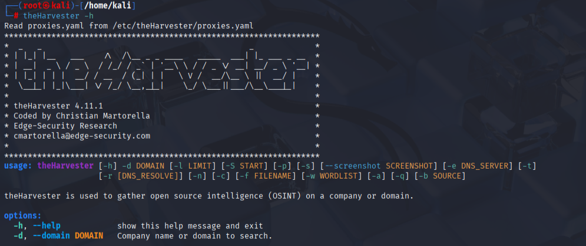
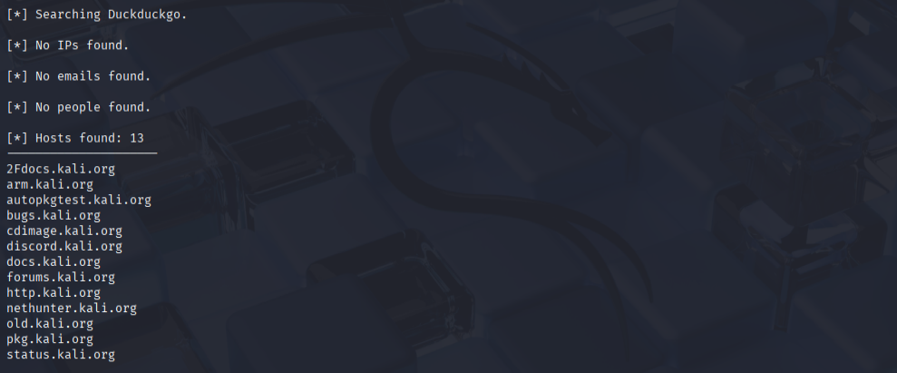

# Complete Guide to Using the WHOIS Tool on Kali Linux
WHOIS is an essential command-line utility used during the footprinting and information-gathering phases of a penetration test. 
It queries global databases to retrieve registration details for internet resources, such as domain names and IP address blocks.

## Step 1: Install the WHOIS Tool

Kali Linux typically comes with whois pre-installed. If you are using a minimal installation or need to restore it, use the following 
commands in your terminal:

* Update your system package repository 

                                                    sudo apt update
                                                               
* Install the WHOIS utility package
       
                                                sudo apt install whois -y

## Step 2: Perform a Basic Domain Lookup

To gather information on a specific domain name, pass the target domain directly as the command argument.

                                                 whois wikipedia.org

  

                                                
### Analyzing the Output:
The database will return a detailed plain-text report. Key fields to extract and analyze include:
* Domain Name: wikipedia.org
* Registrar: MarkMonitor Inc. (The company where the domain was purchased)
* Creation Date: 2001-01-13 (Tells you how long the target infrastructure has existed)
* Registry Expiry Date: 2027-01-13 (The next timeline milestone for the domain renewal)
* Name Servers:
	* ns0.wikimedia.org
	* ns1.wikimedia.org
	* ns2.wikimedia.org

## Step 3: Perform an IP Address Lookup

WHOIS can trace network block ownership and identify hosting providers by scanning individual IP addresses rather than domain names.
Query a public IP address: 

                                                   whois 8.8.8.8

  

### Analyzing the Real-World Output
* **NetRange:** 8.8.8.0 - 8.8.8.255 (The specific block range assigned)
* **CIDR:** 8.8.8.0/24 (The routing prefix for the network block)
* **OrgName:** Google LLC (The legal organization operating the infrastructure)
* **Country:** US (The country where the network block is registered)

## Step 4: Advanced Operations
WHOIS outputs are often massive and difficult to scan within a single terminal window. Use standard Linux stream redirections and 
pipes to filter and save your threat intelligence data efficiently.

* **Export Findings to a Report File**

                                   whois wikipedia.org > wikipedia_whois_report.txt
                                   
Save the query results directly into a text document for documentation or documentation logs.

* **View Large Outputs Page-by-Page**

                                               whois wikipedia.org | less
                                               
Pipe your results directly into less to scroll up and down using your keyboard arrow keys. Press q for exit.

* **Target Specific Information Strings**

                                      whois wikipedia.org | grep -i "Expiry Date"
                        

  

Filter out the noise and pull specific parameters by piping the output into grep

## Notes on Modern WHOIS & Privacy

When running lookups on commercial domains, you will frequently notice fields like Registrant Name, Email, or Phone show values 
like "REDACTED FOR PRIVACY".

* **Data Regulations:** Modern privacy frameworks like GDPR restrict registrars from publicly publishing personal contact details 
by default.

* **Privacy Proxies:** Domain owners often use privacy guard proxies to mask their actual physical identities behind the registrar's 
corporate credentials.

# Complete Guide to Using theHarvester on Kali Linux

theHarvester is a powerful open-source intelligence (OSINT) tool pre-installed on Kali Linux. It is designed to gather emails, subdomains, hosts, employee names, open ports, and banners from different public sources like search engines, PGP key servers, and SHODAN databases. It is an essential tool during the passive reconnaissance phase of a penetration test.

## Step 1: Install or Update theHarvester
While theHarvester comes pre-installed on standard Kali Linux distributions, it is highly recommended to update it to ensure all API connectors and search scraping modules are functioning correctly.
**1\. Open your terminal and run the following command to update your package lists**

                                                sudo apt update

**2\. Install or update the tool**

                                         sudo apt install theharvester -y
   
**3\. Verify the installation and view the available command arguments**

                                               theHarvester -h

  

## Step 2: Core Command Syntax

The basic syntax for running a query with theHarvester relies on three core flags:

                                      theHarvester -d [domain] -l [limit] -b [source]
									  
* **-d:** Specifies the target domain or company name you want to investigate.
* **-l:** Limits the number of search results to work through (lower numbers are faster; higher numbers provide deeper scans).
* **-b:** Defines the public data source (e.g., bing, duckduckgo, linkedin, yahoo, or all).

## Step 3: Run a Real-Life Reconnaissance Scan
Let us use a live public entity (kali.org) to demonstrate a real-world passive footprinting scan.
1. Execute the following command to scan for public information using the DuckDuckGo search engine, limiting the analysis to the top 200 results

                                          theHarvester -d kali.org -l 200 -b duckduckgo

**Analyzing the Real-World Output:**

  

The tool will print a structured text report directly into your terminal. Keep an eye out for these key sections:
* **Target Domain Evaluation:** Confirms kali.org is being analyzed.
* **Searching Source:** Indicates it is actively scraping results from DuckDuckGo.
* **Emails Found:** Displays public email addresses linked to the domain (e.g., devel@kali.org, info@kali.org).
* **Hosts/Subdomains Found:** Lists discovered subdomains paired with their resolved IP addresses:
    * **bugs.kali.org** -> 192.0.2.45
	* **pkg.kali.org** -> 192.0.2.98
	* **images.kali.org** -> 192.0.2.112

## Step 4: Advanced Scans and Multi-Source Scraping

To get a comprehensive view of a target's attack surface, you can aggregate data from multiple public platforms or extract business employee networks.

**1\. Broad Multi-Source Scan**
Instead of using a single search engine, use all to pull records across every built-in free module simultaneously

                                      theHarvester -d kali.org -l 500 -b all

  

**2\. Harvest Employee Professional Profiles**
You can target professional networks to map out corporate identity structures and employee naming conventions by passing linkedin as the data source.

                                     theHarvester -d kali.org -l 300 -b linkedin

## Save Findings to an XML/JSON Report File

Passive reconnaissance reports can grow quite large. Use the -f flag to export your output cleanly into both an XML and HTML file format for structured documentation.

                            theHarvester -d kali.org -l 200 -b bing -f kali_recon_report

**Notes On API Keys and Rate Limiting:**
When running comprehensive or frequent scans, you may notice that some advanced engines (like GitHub, Shodan, or Hunter.io) require authentication or throw error blocks.

   * **Free vs. Paid Modules:** Basic engines like Bing, DuckDuckGo, and Baidu work out of the box. Passive scanners like Shodan, Censys, or VirusTotal require an API key.
   * **Adding API Keys:** You can add your custom API tokens directly to theHarvester config file located on your Kali system at /etc/theHarvester/api-keys.yaml using a text editor like nano
     
                                       sudo nano /etc/theHarvester/api-keys.yaml

  * **Rate Limiting:** If you scan too aggressively with a high -l value, public search engines might temporarily block your IP address with CAPTCHAs. Keep limits reasonable or use a proxy/VPN.

# Complete Guide to Using dnsenum on Kali Linux

dnsenum is a powerful, multithreaded CLI utility pre-installed on Kali Linux. It is designed to locate all DNS records and subdomains associated with a target domain. By automating tasks like zone transfers, Google scraping, and brute-forcing, it allows penetration testers to map out a target's network infrastructure comprehensively during the active reconnaissance phase.

## Step 1: Verify or Install dnsenum
dnsenum comes out of the box in standard Kali Linux installations. If you are running a slim environment or need to update the tool to the latest version, use the following commands:

**1\. Update your system's package index**

                                                      sudo apt update
**2\. Install or update the tool**

                                                 sudo apt install dnsenum -y
**3\. Check the version details and view all configuration flags**

                                                       dnsenum --help

  

## Step 2: How dnsenum Works (The Execution Order)
When you run a standard scan, dnsenum executes several automated operations in a specific sequence:
**1\. Name Servers (NS):** Discovers the authoritative DNS servers for the domain.
**2\. MX Records (Mail Exchange):** Identifies mail servers handling corporate email traffic.
**3\. AXFR (Zone Transfer):** Attempts to replicate the entire DNS zone file from the target's name servers.
**4\. Google Scraping:** Scrapes Google search results to find additional subdomains.
**5\. Subdomain Brute-Forcing:** Tests subdomains using a built-in text wordlist.
**6\. Class C Network Range Calculation:** Automatically calculates network ranges based on discovered IPs and performs reverse lookups.

## Step 3: Run a Real-Life Reconnaissance Scan

Let us use a live domain (zonetransfer.me) to demonstrate a real-world active footprinting scan. This specific domain is intentionally misconfigured legally by security researchers to safely demonstrate how DNS data leakage occurs.
1. Execute a basic automated query against the target

                                               dnsenum zonetransfer.me

  

**Analyzing the Output**

The terminal will output organized blocks of critical network data:
* **Host Addresses (A Records):** Shows the primary IP mapping for the core domain.
* **Name Servers (NS Records):** Identifies servers like nsztm1.digi.ninja and nsztm2.digi.ninja.
* **Mail Exchange (MX Records):** Displays the mail handlers for the domain.
* **AXFR (Zone Transfer Status):** Since zonetransfer.me allows it, you will see a dump of the entire DNS map, immediately revealing internal subdomains like office.zonetransfer.me or testing.zonetransfer.me without sending a single brute-force packet.

## Step 4: Advanced Scans and Subdomain Brute-Forcing

On securely hardened enterprise targets, zone transfers (AXFR) will fail. You must rely on advanced arguments and wordlist dictionaries to discover hidden subdomains.

   **1\. Custom Wordlist Brute-Forcing**
To find subdomains that are hidden from search engines, use the -f flag pointing to a text dictionary file (Kali comes with excellent built-in lists)

                                   dnsenum --dnsserver 8.8.8.8 -f /usr/share/dnsenum/dns.txt zonetransfer.me
								   
**Note:** --dnsserver 8.8.8.8 forces the tool to query Google's public DNS instead of your local network resolver, which prevents local DNS caching issues.

  **2\. Speeding Up Scans with Multithreading**

If you are running a large wordlist, boost the speed of your scan by increasing the thread count with the -t flag

                                        dnsenum -t 50 -f /usr/share/dnsenum/dns.txt zonetransfer.me

  **3\. Exporting Results to an XML Document**

To store your reconnaissance evidence for penetration testing reports or to parse them into alternative tools, save the output to an XML file using the -o flag

                                            dnsenum -o target_dns_report.xml zonetransfer.me

											
## Notes on Safe Operational Usage
Because dnsenum performs active probing (brute-forcing thousands of subdomains and requesting complete network zone maps), it leaves distinct footprints in network firewall logs.
   * **Avoid Aggressive Rates:** Sending too many concurrent DNS requests can cause a Denial of Service (DoS) on poor network endpoints or get your IP flagged by an Intrusion Detection System (IDS). Use reasonable thread values.
   * **Failing Zone Transfers:** Do not be alarmed if you see AXFR record query failed: REFUSED. This is normal and means the administrator has properly secured the DNS infrastructure against data exposure.

							
