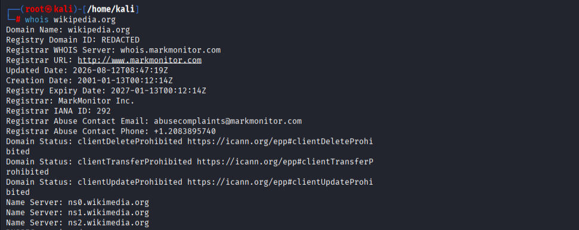
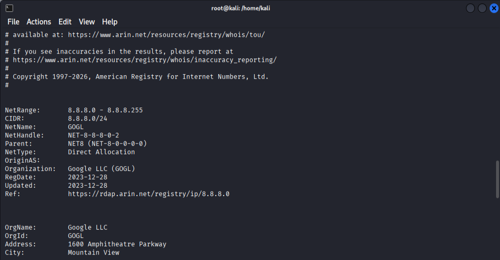
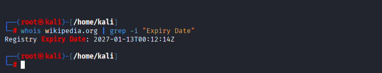

# Complete Guide to Using the WHOIS Tool on Kali Linux
WHOIS is an essential command-line utility used during the footprinting and information-gathering phases of a penetration test. 
It queries global databases to retrieve registration details for internet resources, such as domain names and IP address blocks.

## Step 1: Install the WHOIS Tool

Kali Linux typically comes with whois pre-installed. If you are using a minimal installation or need to restore it, use the following 
commands in your terminal:

* Update your system package repository 

                                                    sudo apt update
                                                               
* Install the WHOIS utility package
       
                                                sudo apt install whois -y

## Step 2: Perform a Basic Domain Lookup

To gather information on a specific domain name, pass the target domain directly as the command argument.

                                                 whois wikipedia.org

  

                                                
### Analyzing the Output:
The database will return a detailed plain-text report. Key fields to extract and analyze include:
* Domain Name: wikipedia.org
* Registrar: MarkMonitor Inc. (The company where the domain was purchased)
* Creation Date: 2001-01-13 (Tells you how long the target infrastructure has existed)
* Registry Expiry Date: 2027-01-13 (The next timeline milestone for the domain renewal)
* Name Servers:
	* ns0.wikimedia.org
	* ns1.wikimedia.org
	* ns2.wikimedia.org

## Step 3: Perform an IP Address Lookup

WHOIS can trace network block ownership and identify hosting providers by scanning individual IP addresses rather than domain names.
Query a public IP address: 

                                                   whois 8.8.8.8

  

### Analyzing the Real-World Output
* **NetRange:** 8.8.8.0 - 8.8.8.255 (The specific block range assigned)
* **CIDR:** 8.8.8.0/24 (The routing prefix for the network block)
* **OrgName:** Google LLC (The legal organization operating the infrastructure)
* **Country:** US (The country where the network block is registered)

## Step 4: Advanced Operations
WHOIS outputs are often massive and difficult to scan within a single terminal window. Use standard Linux stream redirections and 
pipes to filter and save your threat intelligence data efficiently.

* **Export Findings to a Report File**

                                   whois wikipedia.org > wikipedia_whois_report.txt
                                   
Save the query results directly into a text document for documentation or documentation logs.

* **View Large Outputs Page-by-Page**

                                               whois wikipedia.org | less
                                               
Pipe your results directly into less to scroll up and down using your keyboard arrow keys. Press q for exit.

* **Target Specific Information Strings**

                                      whois wikipedia.org | grep -i "Expiry Date"
                        

  

Filter out the noise and pull specific parameters by piping the output into grep

## Notes on Modern WHOIS & Privacy

When running lookups on commercial domains, you will frequently notice fields like Registrant Name, Email, or Phone show values 
like "REDACTED FOR PRIVACY".

* **Data Regulations:** Modern privacy frameworks like GDPR restrict registrars from publicly publishing personal contact details 
by default.

* **Privacy Proxies:** Domain owners often use privacy guard proxies to mask their actual physical identities behind the registrar's 
corporate credentials.

                                    

